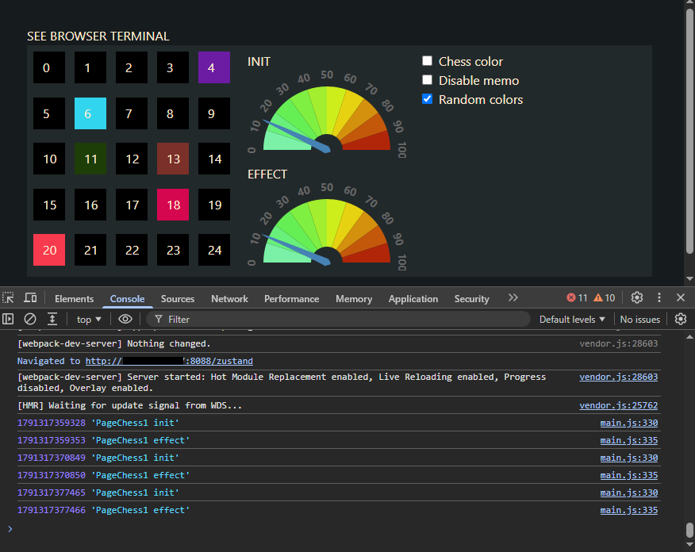

# React zustand meter

Stack
- webpack cjs
- react
- JSX
- production non minified clean
- tailwind 4 local cdn file

Run
- npm run build
- npm run dev  (as dev server)

3 pages
- /meter
- /eventemitter3
- /zustand

